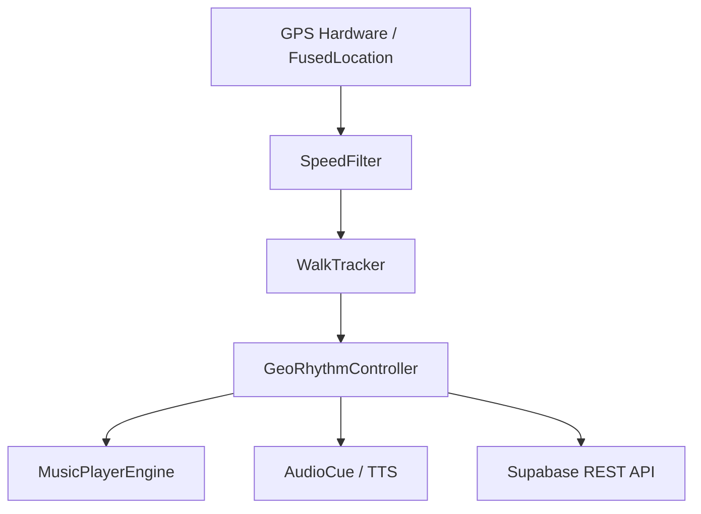

# Arquitectura de GeoRhythm 🎧🏛️

## Visión General
GeoRhythm integra navegación peatonal paso a paso en San Juan de Pasto con sincronización sonora basada en cadencia corporal.

## Capas Principales
1. **Core**: `GeoRhythmController` actúa como orquestador principal; `WalkService` garantiza ejecución continua con pantalla apagada.
2. **Audio**: ExoPlayer con control dinámico de `playbackParameters` (pitch y speed) para ajustar el tempo de pistas de Audius al ritmo del usuario.
3. **Datos y Tracking**: `WalkTracker` gestiona desvíos, cálculo Haversine vía `GeoMath`, y detección de llegada a paradas históricas.
